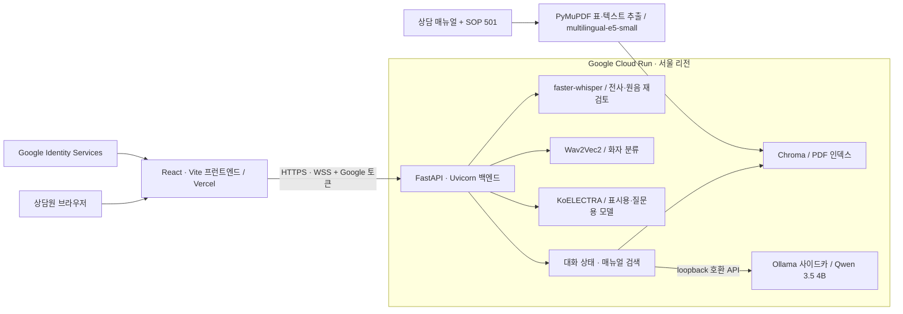
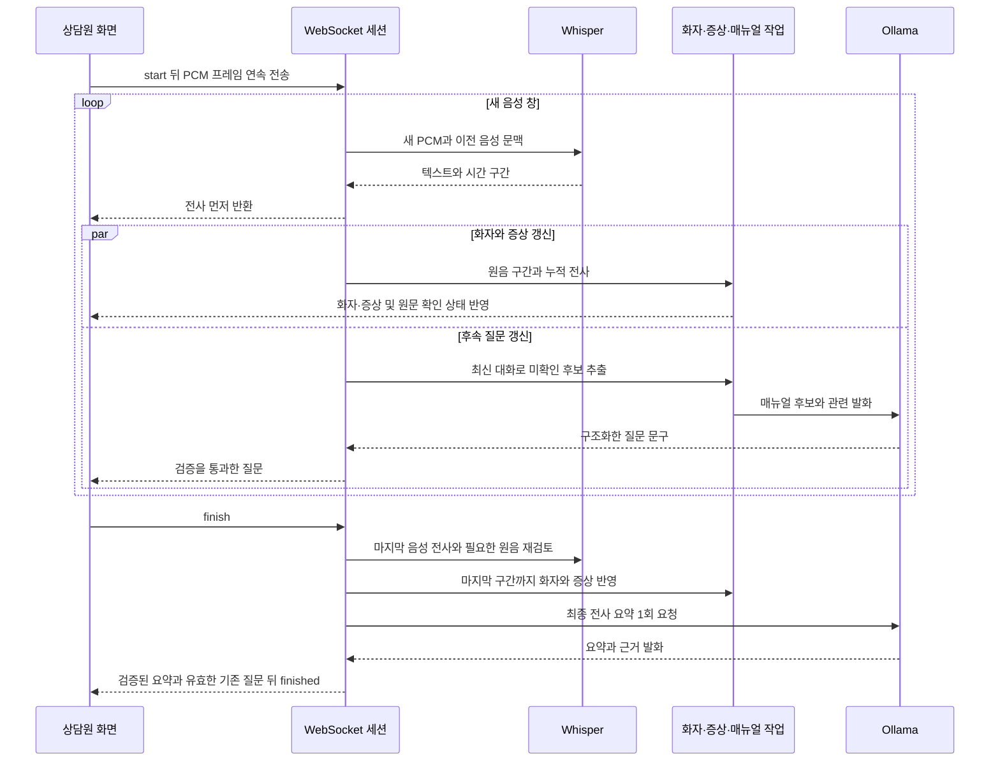
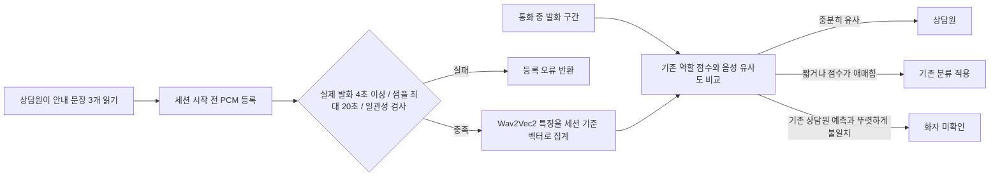
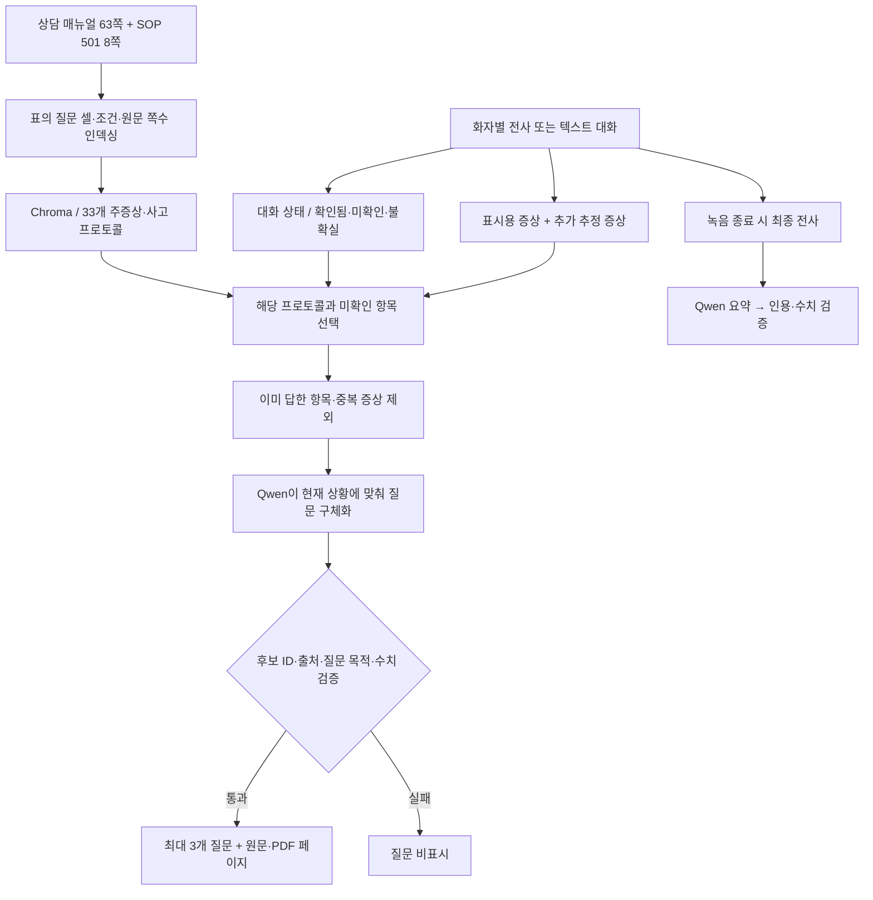
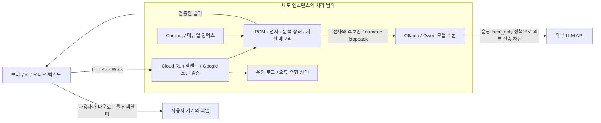

# 119 신고 음성 분석 시스템 구현과 검증

이 시스템은 신고 음성을 실시간으로 전사하고, 상담원이 대화를 읽으면서 화자·증상·매뉴얼 근거 후속 질문을 볼 수 있게 한다. 녹음을 종료하면 최종 전사에 근거한 요약을 생성한다. Whisper, 화자·증상 모델, 매뉴얼 검색은 백엔드에서 실행하고, LLM은 같은 인스턴스의 Ollama로 실행한다. 첨부 매뉴얼을 활용한 연구용 시스템이며 현행 의료 지침의 적용이나 실제 출동 판단은 전문가 검증 범위다.

## 1. 현재 구현 범위

| 기능 | 구현 |
| --- | --- |
| 입력 | 실시간 마이크, 공유한 PC 오디오, 브라우저에서 디코딩한 파일을 재생 속도로 전송, 파일 일괄 업로드, 텍스트 대화 |
| 실시간 전사 | 16 kHz 모노 PCM16을 WebSocket으로 받아 구간별 누적 전사를 먼저 반환 |
| 화자 분류 | Wav2Vec2로 상담원·신고자 역할 표시. 녹음 전 상담원 음성을 등록할 수 있는 백엔드 프로토콜 제공 |
| 증상 분류 | KoELECTRA `라벨v2모델`의 복수 증상을 누적 표시. `원본모델`은 추가 확인 질문 후보에 사용 |
| 후속 질문 | 대화 상태와 매뉴얼 근거로 후보 선정. LLM이 현재 대화에 맞춰 바꿔 쓰며 검증된 질문과 출처를 최대 3개 반환 |
| 상담 요약 | 실시간 녹음을 끝낸 뒤 마지막 전사로 요약 1회 요청. 파일과 텍스트는 단일 요청에서 요약·질문 처리 |
| 매뉴얼 확인 경고 | 별도로 구현한 원문 위험 조건을 알리고 출처를 표시. 긴급도 단계 계산과 응답 필드는 삭제 |

상담원 음성 등록은 백엔드 API에 적용돼 있다. 현재 React 클라이언트에는 등록 화면이 없으며 이전 긴급도 카드 틀과 범례가 남아 있다. [실시간 API](API.md#실시간-음성-분석--websocket-apiv1analysisrealtime)

## 2. 시스템 구조와 기술 스택

| 계층 | 기술 | 역할 |
| --- | --- | --- |
| 화면·오디오 | React 19, Vite 8, AudioWorklet, Web Audio API | 입력 선택, PCM 변환, 스트리밍, 전사·질문·요약 표시 및 사용자 다운로드 |
| API·오디오 | Python, FastAPI, Uvicorn, Pydantic, asyncio, PyAV, NumPy | REST·WebSocket, 입력·응답 검증, 작업 분리, 디코딩과 리샘플링 |
| 모델 실행 | faster-whisper·CTranslate2, PyTorch, Transformers | CPU 전사, 재인식, 화자 분류, 증상 분류 |
| 검색·생성 | PyMuPDF, sentence-transformers, Chroma, Ollama, HTTPX | PDF 구조 보존, 임베딩·검색, 호환 API 호출, 구조화 응답 검증 |
| 접근·운영 | Google 로그인, Docker, Artifact Registry, Cloud Run, Cloud Build, Vercel | 접근 확인, 이미지 패키징·배포, 검증 리비전과 트래픽 전환 |
| 개발 검증 | pytest, Ruff, 가상 대화·PCM 회귀 도구 | API 계약, 비동기 작업, 모델 예외, 근거 검증, 형식 검사 |

실시간 입력은 `/api/v1/analysis/realtime`, 파일 일괄 분석은 `POST /api/v1/analysis/file`, 텍스트 질문 추천은 `POST /api/v1/rag/recommend`로 받는다. 프런트는 `GET /api/v1/analysis/config`에서 서버 기능 지원 여부를 읽는다. [전체 API 계약](API.md)

## 3. 실시간 분석 흐름

- 오디오 형식은 16,000 Hz·16 bit·모노다. 100 ms 프레임은 3,200바이트, 한 프레임의 최대치는 1초다. 600초 분량의 PCM 자체는 약 19.2 MB이며 디코딩과 큐의 복사본은 별도다.
- Whisper는 운영에서 `small` CPU INT8을 사용한다. 기본 새 입력과 이전 음성 문맥은 각각 최대 6초다. 시간 정보로 겹친 글을 정리하고, 적체 시 창을 묶어 전사하며 `beam 1`과 최대 2초 문맥을 사용한다.
- 전사, 화자, 증상, 질문은 서로 독립적으로 갱신될 수 있다. 종료 시 남은 PCM을 비우고 화자 처리까지 마친 뒤 요약을 시작한다. 새 전사가 생성되면 늦게 도착한 결과가 정정 내용을 덮지 않도록 순서와 전사 버전을 관리한다.
- 반복 숫자·문구나 의심 발화는 별도로 검사한다. 필요한 경우 사전 로드한 `whisper-turbo`로 제한된 원음 구간을 재인식한다.
- 운영의 질문 분석 최소 간격은 20초다. LLM 실패 시 전사와 증상 결과는 계속 보낼 수 있으며, 검증된 질문 결과가 없으면 후속 질문은 비워 둔다.

## 4. AI 모델과 사용 목적

| 모델 | 입력·출력 | 구현 결정 |
| --- | --- | --- |
| Whisper `small` | PCM → 전사, 발화 시간 | 일반 파일과 실시간 전사. CPU INT8 |
| Whisper `turbo` | 검토할 원음 구간 → 정정 후보 | 의심 구간에 한정하고 모델 인스턴스 재사용 |
| Wav2Vec2 역할 체크포인트 | 발화별 음성 → 상담원·신고자·미확인 | VAD로 발화 구간을 나누고 전사와 겹친 시간이 가장 긴 화자를 선택 |
| KoELECTRA `라벨v2모델.pt` | 전사 → 8개 증상의 독립 점수 | 각각 sigmoid 0.5 이상이면 채택. 누적 전사와 개별 발화를 함께 사용해 앞에서 언급한 증상을 보존 |
| KoELECTRA `원본모델.pt` | 신고자 발화 → 추가 확인용 증상 가설 | 표시용 증상과 겹치거나 이미 언급된 항목은 제외. 질문 후보의 우선순위와 출처에만 사용 |
| `multilingual-e5-small` | 매뉴얼 구간·검색문 → 임베딩 | Chroma 검색과 프로토콜 메타데이터 필터에 사용 |
| Qwen 3.5 4B | 발화 근거·후보 → 구조화 요약·질문 | Ollama 내부 호출. 요약 인용과 후속 질문의 확인 목적·출처·수치를 서버에서 검증 |

표시용 증상 8종은 고열, 구토·오심, 두통, 복통, 어지러움, 열상, 전신쇠약, 호흡곤란이다. 증상 점수는 모델 출력값이며 환자 상태는 대화에서 실제로 보고된 내용과 구분한다. [모델 입출력 계약](../models/README.md)

### 상담원 음성 등록

이미 설치된 역할 분류 모델의 은닉 표현을 재사용한다. 별도 모델 다운로드나 통화별 재학습이 필요 없다. 특징 벡터는 같은 WebSocket 연결에서만 사용한다. 등록 오디오는 전사, 요약, 후속 질문, 통화 길이 집계에서 제외한다. [등록 계약](API.md#실시간-음성-분석--websocket-apiv1analysisrealtime)

## 5. 매뉴얼 기반 후속 질문과 요약

매뉴얼 인덱스에는 문서 **2개·71쪽**, 프로토콜 **33개**, 인덱스 단위 **1,124개**, 질문 **245개**가 있다. PDF 추출 검토 426개와 질문-상태 연결 검토 12개는 빈 셀·번호·조건 등 자동화에서 확인이 필요한 항목이다. 현행 지침에 대한 의료진 검증은 별도다. [인덱싱과 원문 추적](RAG.md#데이터와-원문-추적)

예를 들어 호흡곤란이 이미 확인되고 질문용 모델에서 두통이 추가로 나온 경우, 관련 매뉴얼 근거가 있으면 “환자분은 두통도 함께 있나요?”처럼 미확인 항목을 질문 후보로 다듬는다. 이미 답한 두통은 다시 제시하지 않는다. 요약은 대화에 존재하는 발화 인용과 수치 검증을 거치며 종료 요약에는 추가 추정 증상을 사실로 넣지 않는다.

## 6. 개인정보와 접근 제어

| 데이터·경로 | 처리 방식 |
| --- | --- |
| 사용자 음성과 텍스트 | 운영에서는 Google Cloud Run 인스턴스까지 전송된다. 업로드 파서가 OS 임시 파일을 사용할 수 있으며 요청 종료 시 파일을 닫는다. 실시간 원음과 중간 상태는 세션 메모리에 유지한다. |
| LLM 입력 | `local_only` 모드의 Qwen은 같은 인스턴스에서 실행한다. NER를 생략하므로 모델에 전달되는 전사 안에는 이름·주소·병력 등 식별 가능한 내용이 포함될 수 있다. |
| 인증 | Google 로그인 토큰을 백엔드에서 검증한다. REST의 Bearer 헤더와 WebSocket 서브프로토콜을 사용하고, 인증된 응답에는 `Cache-Control: no-store`를 붙인다. |
| 저장·관측 | 앱에 통화 기록 DB가 없고 Chroma에는 매뉴얼만 저장한다. 모델 오류 로그에는 유형·HTTP 상태·고정 원인 코드가 남는다. Ollama 요청 본문 로그와 클라우드 기능은 꺼져 있다. |
| 기존 외부 모델 경로 | 서비스 코드에 남아 있는 Gemini 경로에도 정책 검사가 적용된다. 운영 설정은 로컬 전용이며 외부 호출 활성화와 정책 확인이 필요하다. |

개인 PC에 둔 로컬 개발 환경과 운영 배포의 차이는 **처리 위치**다. 개발에서는 해당 PC 안에서 처리하고, 운영에서는 같은 Cloud Run 인스턴스 안에서 백엔드와 모델이 처리한다. 메모리·임시 파일·운영 계정 권한에 대한 기관 보안 검증은 별도다. [개인정보 안정화 기록](PRIVACY_STABILITY.md) · [Cloud Run 배포 안내](CLOUD_RUN.md)

## 7. 시행착오와 결정 근거

| 관찰한 문제 | 확인 및 수정 |
| --- | --- |
| 외부 LLM 연결과 개인정보 경계 | 발화 일부를 가려도 장소·병력 등으로 재식별될 수 있어 운영을 `local_only`로 전환했다. Cloud Run의 PC용 `127.0.0.1` 오해는 같은 인스턴스에 Ollama 사이드카를 붙여 해결했다. |
| 질문에 “안전합니까?” 같은 원문 표현이 반복됨 | 명시된 현장 단서가 있을 때만 안전 관련 후보를 남긴다. 대화 상태로 미확인 질문을 선택한 뒤 LLM에 상황에 맞게 바꿔 쓰게 하고, 검증 실패 시 표시하지 않는다. |
| Whisper의 반복 숫자·짧은 발화, 문맥 부족 | 힌트·접두어를 빼고 음성 문맥을 보존했다. 타임스탬프를 적용해 창의 중복을 제거하고, 이상 반복은 원음 구간으로 검토한다. |
| `base`는 빠르지만 오류가 많고 `small`은 느림 | 같은 네 구간으로 `base`, `small`, WhisperLiveKit, CrisperWhisper, Zipformer, SenseVoice를 비교했다. 파일·실시간에는 `small`, 적체 시 경량 디코딩, 필요한 곳만 `turbo`로 재검토하는 구성을 사용했다. |
| 재검토마다 `turbo` 가중치를 다시 읽음 | 준비 시 모델을 불러두고 검토 요청에서 재사용한다. 반복 로딩 비용이 줄었고 메모리 상주량은 늘었다. |
| 세 번째 증상을 말할 때 앞의 증상이 사라짐 | 누적 텍스트와 개별 안정 발화를 함께 분류하고 증상별 최고 점수를 결합한다. 전사 정정 시 증상 분류를 다시 계산한다. |
| 종료 때 화자가 늦게 붙고 요약 이후 질문이 사라짐 | 잔여 음성의 화자 분류를 기다린 뒤 최종 요약한다. 마지막 전사에도 근거가 유효한 기존 질문은 최종 결과에 함께 보낸다. |
| 긴급도 규칙과 LLM 판단이 혼재함 | 처음에는 규칙 기반 긴급도를 시험했다. 최종 백엔드에서 단계 산정과 필드를 제거하고 원문 확인 경고와 후속 질문에 집중했다. |

## 8. 수치로 본 검증 결과

CER은 정답 전사와 비교한 문자 단위 오류율이며 낮을수록 좋다. 서로 다른 표본의 CER을 직접 합산하지 않았다. 이 문서에는 평가에 사용한 통화 원문이나 녹음을 싣지 않았다.

### 전사 속도와 정확도 비교

동일한 한국어 통화 4개 구간, 총 81.08초를 같은 Windows PC에서 비교했다. 첫 표시는 미확정 텍스트를 포함할 수 있다. 화자·증상·LLM·재검토 시간은 별도다.

| 구성 | 가중 CER | 평균 첫 표시 | Stop 후 평균 | 디코딩 시간 합계 |
| --- | ---: | ---: | ---: | ---: |
| Whisper `base`, 기존 설정 | 72.6% | 7.4초 | 1.91초 | 28.6초 |
| Whisper `small`, 현재 비교 설정 | 43.5% | 11.3초 | 5.86초 | 63.8초 |
| Whisper `small`, 첫 입력 4초·문맥 4초, 실험 구성 | 42.2% | 6.2초 | 3.42초 | 46.3초 |
| CrisperWhisper 한국어 `base` INT8 | 68.5% | 6.7초 | 3.48초 | 36.3초 |
| 한국어 Zipformer 72M INT8 | 84.1% | 2.3초 | 0.04초 | 4.2초 |

SenseVoice INT8은 비교 구간에서 유효한 한국어 전사가 거의 없었다. 별도 비교에서 WhisperLiveKit과 기존 방식에 같은 `base` 가중치를 적용하면 CER은 각각 **64.8%, 72.6%**였지만 첫 확정 평균은 **47.6초, 7.1초**, Stop 후 평균은 **53.8초, 1.9초**였다. 기존 스트리밍 방식을 유지한 이유다. 첫 입력 4초·문맥 4초 조합은 실험값이다. [모델·방식 비교 기록](STT_QUALITY.md)

### 기능별 검증

| 검증 항목 | 관찰 결과 | 해석 범위 |
| --- | --- | --- |
| PCM 분할·문맥 개선 | 가중 CER 57.57% → 37.94%, STT 처리 합계 98.5초 → 63.0초 | 세 통화의 앞부분 120.745초, 6초 문맥을 보존한 로컬 설정 비교 |
| `turbo` 재검토 모델 재사용 | 평균 15.26초 → 9.82초, 약 36% 단축. 미리 로드하는 데 5.96초 | 같은 11초 음성을 구성별 두 번 실행. 작업 집합 약 0.9 GiB 증가, 전체 백엔드 메모리 사용량은 별도 |
| STT가 증상 검출에 미치는 영향 | 전신쇠약 점수 0.3442 → 0.5918, 기준 0.5 통과 | 100.8초 단일 파일의 과거 설정 비교. 최신 `라벨v2` 전체 정밀도는 이 수치로 평가할 수 없음 |
| 복수 증상 누적 | 가상 전사에서 호흡곤란·전신쇠약·두통 세 항목을 함께 표시 | 새 모델을 넣은 컨테이너 검증. 임상 성능 지표는 별도로 평가해야 함 |
| 상담원 음성 등록 | 지정 화자 발화 12개 중 0개 → 11개 식별, 비교 타 화자 발화 12개 중 상담원 오분류 0개 | 공개 영어 음성 두 명의 소규모 비교. 한국어 통화와 채널 차이에 대한 평가는 미실시 |
| 로컬 LLM 통합 | 가상 대화 1건에서 요약 1개·질문 3개 생성, 전체 요청 약 34.1초 | 로컬 Windows 백엔드와 Ollama를 함께 실행한 값. 운영 실시간 응답 지연은 별도 |
| 회귀·배포 검증 | 백엔드 테스트 232개 통과. 이미지에서 긴급도 제거·음성 등록 초기 교환 확인 | 운영 요청의 Google 인증 보호와 CORS 확인. 실제 운영 통화의 지연·정확도는 미측정 |

근거 자료는 [전사 품질 검증](STT_QUALITY.md), [증상 단일 파일 회귀](FOLLOWUP_FIXES.md), [공개 화자 음성](https://github.com/speechbrain/speechbrain/tree/develop/tests/samples/ASR)이다.

## 9. 운영 배포와 검증 방법

- 2026-11-26에 백엔드 커밋 `20faae3`을 서울 Cloud Run 리비전 `emergency-backend-00014-kup`에 배포했다. 기존 운영 이미지에 포함한 모델과 매뉴얼 인덱스를 재사용해 앱 코드를 갱신했다.
- 백엔드 **4 vCPU·8 GiB**, Ollama **4 vCPU·6 GiB**로 설정했다. 사이드카에 Qwen을 포함해 실행 중 가중치를 내려받을 필요가 없다. Cloud Run의 시작 검사는 Ollama를 확인하고 백엔드를 시작한다.
- 기본 주소와 `auth-check` 주소가 모두 새 리비전에 연결됐다. 요청 인증과 CORS는 두 주소에서 확인했으며, 사용자 로그인 후 실제 통화 전체의 운영 성능은 아직 계측하지 않았다.

## 10. 발표 구성

| 순서 | 주제 | 발표 자료에 옮길 내용 |
| --- | --- | --- |
| 1 | 해결하려는 문제 | 실시간 통화 중 받아쓰기, 증상, 다음 확인 질문을 한 흐름에서 제공 |
| 2 | 전체 구조 | 브라우저 → Cloud Run → 전사·분류·RAG → 동일 인스턴스 Ollama |
| 3 | 실시간 처리 | 전사는 먼저, 화자·증상·질문은 별도 갱신, 녹음이 끝나면 요약 |
| 4 | 모델과 매뉴얼 | 두 KoELECTRA 모델의 역할, 상담원 음성 등록, 33개 프로토콜·245개 질문 |
| 5 | 개인정보 | 브라우저에서 운영 인스턴스까지의 전송 범위, 앱 저장 정책, LLM 내부 호출 |
| 6 | 시행착오와 성능 | `base`·`small` 속도와 CER, WhisperLiveKit 비교, 모델 재사용과 화자 등록 실험 |
| 7 | 구현 결과와 검증 범위 | 테스트 232개, 배포 구조, 실제 한국어 통화의 정확도·지연과 전문가 검증 과제 |
